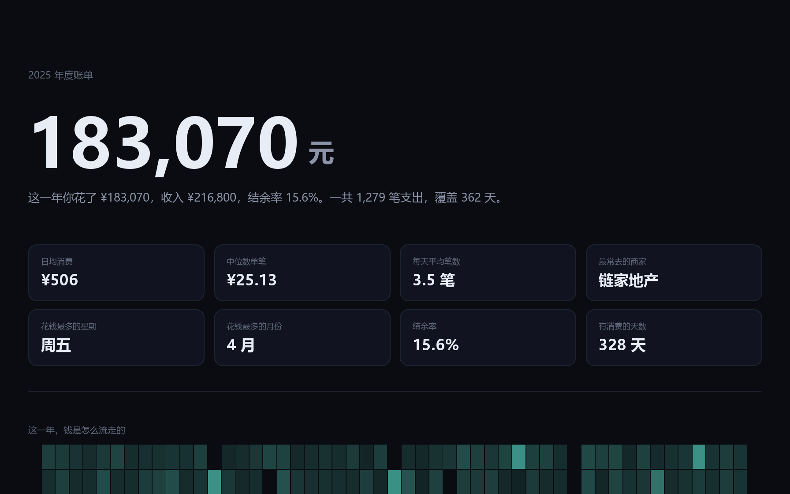

# BillBook

把支付宝 / 微信的账单导出文件，变成一份**可以离线打开的年度报告**。
一个 HTML 文件，双击就能看，不上传、不联网、不装东西。



---

## 为什么做这个

每到年底，支付宝和微信都会给你一份"年度账单"。但那份东西：

- 只能在他们自己的 App 里看，导不出来
- 分类是他们定的，"商户消费"这种类目占了半屏，什么也说明不了
- 两边的分类粒度不一样，同一顿饭在支付宝叫"餐饮美食"，在微信叫"商户消费"
- 看不到自己真正想知道的：钱是哪几个月失控的、一天里什么时候最爱花钱、哪几笔明显不正常

自己算一遍其实不难，难的是**脏数据**：表头在第几行不固定、金额带千分位、编码有时是 GBK、
微信的"收/支"列有一堆是空的、同一笔在两个平台各出现一次。
这个工具主要就是解决这些。

## 它解决的具体问题

| 坑 | 处理方式 |
| --- | --- |
| 支付宝 CSV 前面有 4 行导出说明 | 扫到同时含"交易时间"和"金额"的那一行才当表头 |
| 平台改版后列顺序变了 | 按**列名**映射字段，不按列号 |
| 金额写成 `1,234.56` / `¥99` / `￥1,280` | 统一清洗，取绝对值 |
| 文件编码有时是 GBK | 依次尝试 utf-8-sig / utf-8 / gb18030 / gbk |
| 微信 xlsx（没有 openpyxl） | 自己实现了最小的 xlsx 读取器，只依赖标准库 zipfile + ElementTree |
| 微信"收/支"列留空 | 看说明里有没有"还款""自动转入"，有就判为不计收支 |
| 信用卡还款、余额宝转入被算成支出 | 归为 `neutral`，不进任何统计 —— **这是账单工具最容易错的地方**，几千块会凭空多出来 |
| 两个平台导了同一笔 | 用「时间+金额+对方+收支」做指纹去重 |
| 房租每月 5200，一定"异常" | 常去的商家（一年 6 笔以上）和它自己的中位数比，偶发的才和日均比 |
| 「最贵的几笔」全是房租 | 同一个商家最多留 2 笔 |

## 用法

```bash
# 支持通配符，一次可以给多个文件（支付宝 + 微信混着给也行）
python -m billbook ~/Downloads/alipay_record_2025.csv \
                   ~/Downloads/微信支付账单*.xlsx \
                   -o 2025.html --open

# 只统计某一年
python -m billbook 账单.csv -y 2024

# 生成但不打开
python -m billbook 账单.csv -o out/2025.html
```

终端里会顺带打一份概要：

```
  读取 alipay_record_2025.csv → 793 条
  读取 微信支付账单(20250101-20251231).xlsx → 526 条

  2025 年
  支出  ¥183,070.45   （1,279 笔）
  收入  ¥216,799.97   （16 笔）
  结余率 15.6%
  日均  ¥505.72

  花在哪：
    住房    ████████                 36.8%  ¥   67,303.23
    数码    ████                     20.1%  ¥   36,770.32
    购物    ██                       10.6%  ¥   19,466.70
    ...
```

## 报告里有什么

报告是**纯静态 HTML**：图表在 Python 里算好、拼成内联 SVG 写进去，
页面里的 JS 只做滚动淡入和数字滚动。所以它不需要网络，可以直接发微信、可以打印成 PDF。

| 区块 | 内容 |
| --- | --- |
| 首屏 | 总支出（数字滚动）、收入、结余率、8 个 KPI |
| 全年日历 | 53×7 网格，每天一个方块，深浅=当天花了多少 |
| 按月 | 支出柱 + 收入折线，一眼看出哪个月失控 |
| 钱花在哪 | 13 个自定义类目的横条，带金额和占比 |
| 什么时间花 | 星期 × 24 小时热力图 |
| 和谁打交道 | 商家 Top10，按金额排序，附笔数 |
| 最贵的几笔 | 同一商家最多 2 笔 |
| 这几笔不太对 | 相对自己而言的异常消费，附「是平时的几倍」 |
| 消费人格 | 按最显著的统计特征给一个标签（房奴型 / 装备党 / 干饭人 …） |

## 分类是怎么做的

不用平台自带的分类，因为两个平台的粒度对不上。改按「交易对方 + 商品说明」做关键词匹配，
13 个类目，顺序即优先级：

```
住房 → 交通 → 医疗 → 教育 → 会员订阅 → 数码 → 餐饮 → 购物 → 娱乐 → 通讯 → 人情 → 金融 → 其他
```

顺序有讲究。比如「宽带」必须在「餐饮」之前，否则「中国电信 宽带续费」会因为
"餐"这个字被分到餐饮 —— 这是实际踩过的坑。

匹配不上时回退到平台原始分类的映射表，再不行归「其他」。

## 目录

```
billbook/
  billbook/
    parse.py        # 账单解析、脏数据清洗、去重
    xlsx.py         # 最小 xlsx 读取器（std lib，无第三方依赖）
    categorize.py   # 13 类消费归类 + 商家名归一
    stats.py        # 统计、异常检测
    report.py       # 年度报告 HTML（内联 SVG）
    preview.py      # 同样的数据用 Pillow 重画一份（验收 + 视频素材）
    cli.py
  tools/
    make_sample.py  # 造演示账单（含各种脏数据）
    test_parse.py   # 63 条断言，python 直接跑，不需要 pytest
    check_report.py # 静态检查 HTML：SVG 越界、NaN、空章节、未解析占位符
    svg2png.py      # 无浏览器环境下把报告里的 SVG 光栅化，肉眼看图
    preview.py      # 渲染整页 PNG
  demo/             # 演示账单（造出来的，不是真实数据）
```

## 验收方式

这台机器上 headless 浏览器起不来（`mojo platform_channel` 拒绝访问），所以没法截图验 HTML。
改成三条独立的检查：

```bash
python tools/test_parse.py              # 63 passed
python tools/check_report.py out/2025.html   # 0 error
python tools/svg2png.py out/2025.html out/charts   # 把每个图表画成 PNG 肉眼看
python tools/preview.py demo/*.csv demo/*.xlsx -o out/page.png
```

`check_report.py` 查的是这些：SVG 的 rect 有没有越界或负宽高、有没有 NaN 坐标、
polyline 点有没有飞出画布、图表数量够不够、关键区块在不在、`¥` 后面是不是数字、
CSS 变量有没有没定义的、内联 JS 括号配不配平。

## 配套短视频

两条 1080×1920 竖屏、30fps、配乐，Pillow 逐帧绘制 + ffmpeg 编码。
数字全部来自 `demo/` 里那份 1,319 条的演示账单，跑一遍就能复现。

| 文件 | 时长 | 讲什么 |
| --- | --- | --- |
| `../video-music/out/v1-billbook-music.mp4` | 40s | 《你的年度账单多算了 6 万 2》：24 笔「不计收支」被当成消费，支出虚高 34.2% |
| `../video-music/out/v2-rhythm-music.mp4` | 42s | 《你的钱有作息》：按小时/按日期看这一年，328 个有消费的日子、12 点与 18 点两个峰、每月 1 号走掉 36% 的钱 |

```bash
python video/v1.py
python video/v2.py
python video/v2.py stills 8 19.5 27    # 只出单帧
```

两条片子按竖屏信息流的三条规则排过版：第 0 帧就得能读（列表里它就是封面）、
关键文字压在 y ≤ 1250（底部 35% 会被字幕和按钮盖住）、
带 alpha 的填充必须用 `ImageDraw.Draw(img, "RGBA")`（RGB 模式会静默丢掉 alpha 分量）。

## 已知限制

- **只处理支出侧的分析**，收入只用来算结余率
- 分类是关键词规则，不是模型。遇到没见过的商家名会落到「其他」，需要自己加词
- 账单里没有商品明细，所以「这个月为什么这么贵」只能回答到商家/类目这一层
- 不做预算提醒、不做多年度对比（还没做）
- 只在 Windows + Python 3.13 上验证过；代码里没有平台相关的东西，但没测过 mac/Linux

## 隐私

全部在本地算。不发网络请求，报告里也不含明文卡号 / 订单号。
报告文件本身包含你的消费明细，发给别人之前想清楚。
